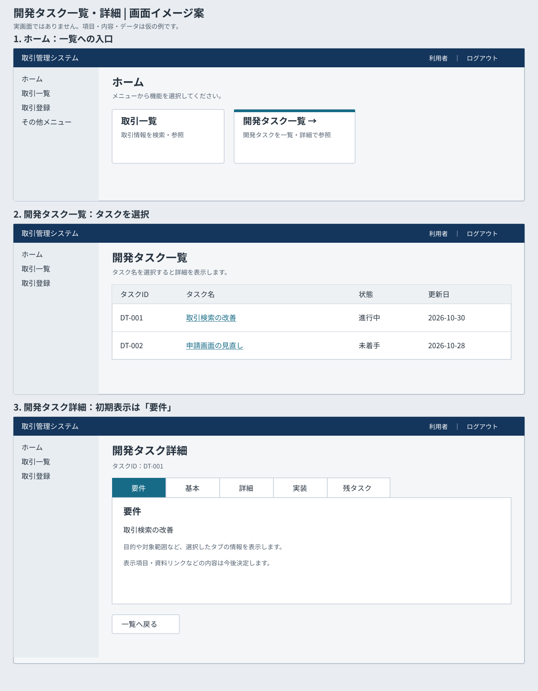

# 開発タスク一覧・詳細 基本設計

## 1. 文書情報・対象

| 項目 | 内容 |
|---|---|
| 対象 | 開発タスク一覧・詳細の参照 |
| 状態 | 参照機能を実装済み。実データの運用などは未決 |
| 根拠 | [開発タスク要件案](../2.要件資料/development-task-requirements.md) |
| 現行システム | [基本設計書](basic-design.md) |

実装に基づく具体的なAPI・DB・ストア仕様は[技術詳細設計](../4.詳細設計/details/development-task-design.md)、画面は[画面詳細設計](../4.詳細設計/screens/development-tasks.md)を参照する。

## 2. 構成・権限

ブラウザのVue画面からBackendのAPIを呼び出す。タブごとの情報はPiniaの一時ストアに保持する。取得元はH2の開発タスク用データであり、外部APIへの接続は設けない。テーブルが空の場合、起動時にサンプル2件を投入する。

既存のセッション認証を利用し、ホーム・一覧・詳細とAPIはいずれもログイン必須。USER・ADMINの双方が閲覧可能で、API側でも認証する。タスク単位の制限は設けていない。参照機能のみで更新処理はなく、新規の操作監査は設けていない。監査要否は未決。

## 3. 画面・遷移

図は表示例であり、データや項目は仮のもの。画面キャプチャではない。

| 画面 | パス | 役割 |
|---|---|---|
| ホーム | `/` | 既存メニューカードに「開発タスク一覧」を追加 |
| 開発タスク一覧 | `/development-tasks` | 一覧を表示し、行のタスク名リンクから詳細へ遷移 |
| 開発タスク詳細 | `/development-tasks/:id` | 選択タスクの5タブを表示。一覧へ戻る |

既存の共通ヘッダー・メニューを使用する。ホームのカードを一覧への入口とし、共通メニューへの追加は本案の必須範囲に含めない。一覧のタスク名をリンクにしてキーボードでも選択できるようにする。詳細のURLにタブは含めず、詳細に入るたびに「要件」を選択する。タブはキーボード操作と選択状態の認識に対応する。

### 3.1 一覧の表示案

画面表示時に一覧APIを呼び出す。列はタスクID、タスク名、状態、更新日。状態はDB上の文字列、更新日は日付をそのまま表示する。検索・ページングは対象外。取得中、0件、失敗時はそれぞれ状態を表示する。

### 3.2 詳細の表示案

タスクIDを表示し、要件／基本／詳細／実装／残タスクの順にタブを並べる。各タブはプレーンテキストを表示する。タブごとに取得中、内容なし、取得失敗を区別して表示する。タブ切替のみでは詳細画面から離れない。

## 4. API・データ概要

| API | 用途 | 応答概要 |
|---|---|---|
| `GET /api/development-tasks` | 一覧画面を表示 | タスクID・名称・状態・更新日を持つ一覧。0件は空配列 |
| `GET /api/development-tasks/{id}/tabs/{tab}` | 指定タスクの指定タブを表示 | タスクID、タブ種別、そのタブの表示内容。内容なしも正常応答として区別 |

`tab` は `requirements`、`basic`、`detail`、`implementation`、`remaining` のいずれか。不存在のタスクは404、不正なタブは400を返す。エラー形式は `{code, message, retryable}`。APIで認証する。

## 5. タブ取得とストアの設計

タブ用ストアはタスクIDとタブ種別を識別し、各タブの未取得・取得中・取得成功・取得失敗を区別する。成功時は空の内容も取得済みとして保持する。永続ストレージに保存しない。[認証ストア](../../frontend/src/stores/auth.ts)からも破棄する。

1. 詳細に入ったら「要件」を選択し、そのID・タブに成功済みデータがなければAPIを呼ぶ。他のタブは先読みしない。
2. タブ選択時、対応する成功済みデータがあればAPIを呼ばず表示する。未取得なら取得し、成功した内容を保持する。取得中の同じID・タブへの重複要求は共有または抑止する。
3. 取得失敗を成功済みとして保持しない。エラーを表示し、再試行可能な場合は選択中のタブを再取得できる。別タブの成功済みデータは失敗で消さない。
4. タブを切り替えても成功済みデータを保持する。詳細画面からの遷移が確定したときに全タブを破棄し、遷移がキャンセルされた場合は維持する。詳細内でIDが変わる場合も旧IDの全データを破棄し、新IDの「要件」から開始する。
5. ログアウト開始時に全タブを破棄する。ログアウトAPIの成否にかかわらず残さない。既存のログアウト時の認証情報消去と連携し、401によるセッション切れ時も破棄する。
6. 破棄前に開始された通信が後から成功・失敗しても、破棄後のストアや別タスクの画面を更新しない。要求の取消しに加え、画面・認証世代などで応答の有効性を検証する。同一IDで入り直した場合も古い応答は使わない。

ブラウザ更新ではメモリ上のストアが失われるため、詳細の「要件」を再取得する。詳細から一覧へ戻り再び同じタスクを開いた場合も再取得する。保持中のタブの強制更新は設けない案であり、最新化の要否は未決。

## 6. エラー・運用

- 一覧またはタブの取得中は読み込み状態を表示する。正常な0件・内容なしとエラーを混同しない。
- 401では認証状態とタブの保持値を消去し、ログイン画面へ遷移する。その他のエラーは既存APIエラー形式に従い表示し、再試行可能な場合に再試行を提供する。404は対象なしとして明示する。
- 表示内容はテキストとして扱い、未信頼のHTMLをそのまま描画しない。資料リンクを扱う場合の許可方式は詳細設計で定義する。
- 実データの投入・更新手順、保存先の容量、バックアップ、性能目標と監査の要否は未決。

## 7. 要件対応・検証観点

| 要件 | 対応・検証 |
|---|---|
| DT-R01〜R03 | ホームから一覧、選択したIDの詳細へ移動できる |
| DT-R04〜R05 | 5タブの順序と初期「要件」を確認する |
| DT-R06〜R07 | 初回表示のAPI呼出し、他タブへの切替、再選択時に追加呼出しがないこと、空データも再取得しないことを確認する |
| DT-R08 | 画面離脱、ID変更、ログアウト成功・失敗、401、ブラウザ更新後の破棄・再取得を確認する |
| DT-R09〜R10 | 読込・空・失敗・再試行と一覧復帰を確認する |

加えて、取得中の素早いタブ切替、重複選択、画面離脱・再入場・ID変更・ログアウト後に旧応答が届く場合、認可されないアクセスを検証する。仕様の未決事項は[要件案 §6](../2.要件資料/development-task-requirements.md)を参照する。
