# 基本設計書

## 1. 文書情報

| 項目 | 内容 |
|---|---|
| 文書名 | 取引管理システム 基本設計書 |
| 版 | 0.1（リバースエンジニアリング初版） |
| 実装確認日 | 2026-10-18 |
| 対象 | 本リポジトリの現行実装 |
| 関連資料 | [要件案](../../vue-springboot-external-api-requirements.html) |
| 画面別詳細設計 | [画面別詳細設計一覧](screens/README.md) |
| 詳細設計 | [詳細設計書一覧](details/README.md) |

### 1.1 記載区分

- **実装確認済み**: ソースコードまたは設定値で確認した現行仕様。
- **要件案との差分**: 要件案の記載と現行実装が異なる箇所。
- **未定義／要確認**: ソースコードや設定値だけでは仕様を確定できない事項。

本書は現行実装の説明を目的とする。要件案に記載されている値や機能を、実装されている仕様として補完しない。

## 2. システム概要

本システムは、取引の検索・参照・登録とユーザ管理を行うWebアプリケーションである。ブラウザ上のVue SPAはSpring Bootバックエンド（BFF）を呼び出し、取引データはBFF経由で外部APIから取得・登録する。ユーザ、ロール変更履歴、監査ログはH2データベースに保存する。

### 2.1 システム構成

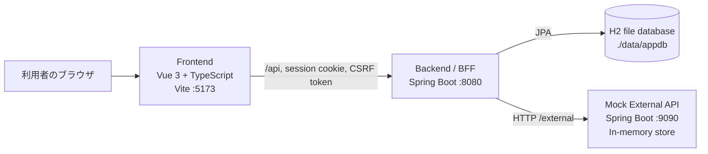

| コンポーネント | 責務 | 実装・接続先 |
|---|---|---|
| Frontend | 画面表示、入力、クライアント側ルーティング、BFF呼び出し | Vue 3、TypeScript、Vite。開発時ポート5173 |
| Backend / BFF | 認証・認可、ユーザ管理、監査記録、取引API中継、外部エラー正規化 | Spring Boot。ポート8080 |
| H2 | ユーザ、ロール履歴、監査ログの永続化 | ファイルDB `./data/appdb` |
| Mock External API | 取引一覧・詳細・登録APIの提供 | Spring Boot。ポート9090。取引データはインメモリ |

### 2.2 利用者と権限

| ロール | 利用可能な機能 |
|---|---|
| USER | ホーム、取引一覧・詳細、取引登録 |
| ADMIN | USERの機能に加え、ユーザ管理 |

認可は画面メニュー、Vue Routerガード、Spring Security API認可の複数箇所で行う。APIの認可を最終的な制御とする。

## 3. 機能設計

| 機能ID | 機能 | 概要 | 主な利用者 |
|---|---|---|---|
| F-01 | ログイン・ログアウト | ユーザIDとパスワードで認証し、セッションを開始・終了する | USER、ADMIN |
| F-02 | セッション確認 | フロント起動時に認証状態を確認する | 全利用者 |
| F-03 | ホーム | ロールに応じた機能メニューを表示する | USER、ADMIN |
| F-04 | ユーザ管理 | ユーザ検索・登録・更新・無効化、ロール変更履歴参照を行う | ADMIN |
| F-05 | 取引検索・一覧 | 条件を指定して外部APIの取引一覧を取得する | USER、ADMIN |
| F-06 | 取引詳細 | 指定した取引の詳細を取得する | USER、ADMIN |
| F-07 | 取引登録 | 入力内容を確認後、外部APIへ登録する。冪等性キーで重複登録を抑止する | USER、ADMIN |
| F-08 | 監査記録 | 認証、ユーザ操作、取引登録の結果を記録する | システム |

### 3.1 画面一覧

| 画面ID | 画面名 | パス | 認証 | 権限 | 概要 |
|---|---|---|---|---|---|
| S-01 | ログイン | `/login` | 不要 | なし | ユーザID・パスワードによるログイン |
| S-02 | ホーム | `/` | 必要 | USER以上 | 機能メニューを表示 |
| S-03 | ユーザ管理 | `/users` | 必要 | ADMIN | ユーザの検索・登録・編集・無効化、ロール履歴参照 |
| S-04 | 取引一覧 | `/transactions` | 必要 | USER以上 | 取引検索、一覧表示、ページ移動 |
| S-05 | 取引登録 | `/transactions/entry` | 必要 | USER以上 | 取引入力、確認、登録 |
| S-06 | 取引詳細 | `/transactions/:id` | 必要 | USER以上 | 取引詳細表示 |

共通レイアウトはログイン後の画面にヘッダー、ログアウト操作、左側メニュー、画面本文を表示する。ユーザ管理メニューはADMINにのみ表示する。

### 3.2 画面遷移

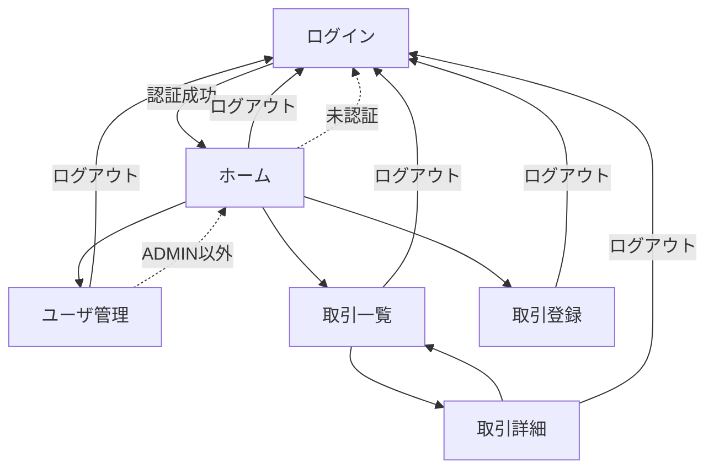

未認証で保護画面へアクセスした場合はログイン画面へ遷移し、遷移先パスをクエリに保持する。ログイン済みでログイン画面へアクセスした場合はホームへ遷移する。ADMIN以外がユーザ管理画面へアクセスした場合はホームへ戻る。

## 4. 外部インターフェース概要

### 4.1 フロントエンド向けAPI

すべてのAPIはBackendの `/api` 配下にあり、取引APIはMock External APIへ中継される。

| 機能 | メソッド・パス | 概要 | 認可 |
|---|---|---|---|
| ログイン | `POST /api/auth/login` | 認証し、セッションを作成 | 公開 |
| ログアウト | `POST /api/auth/logout` | セッションを無効化 | 認証必須 |
| セッション確認 | `GET /api/auth/me` | 認証状態・ユーザ情報を返す | 公開 |
| 取引一覧 | `GET /api/transactions` | 条件・ページ指定で外部APIから取得 | 認証必須 |
| 取引詳細 | `GET /api/transactions/{id}` | 外部APIから詳細を取得 | 認証必須 |
| 取引登録 | `POST /api/transactions` | 入力を検証し、外部APIへ登録 | 認証必須 |
| ユーザ検索 | `GET /api/users` | キーワード、ロール、状態で検索 | ADMIN |
| ユーザ登録 | `POST /api/users` | ユーザを作成 | ADMIN |
| ユーザ更新 | `PUT /api/users/{id}` | ユーザ情報を更新 | ADMIN |
| ユーザ無効化 | `POST /api/users/{id}/disable` | ユーザを無効化 | ADMIN |
| ロール履歴 | `GET /api/users/{id}/role-history` | 対象ユーザのロール変更履歴を取得 | ADMIN |

取引一覧の検索条件は `dateFrom`、`dateTo`、`status`、`partnerName`、`page`、`size`。ページ番号の既定値は0、ページサイズの既定値は10。

取引登録要求は `requestId`、`partnerName`、`amount`、`transactionDate`、`note` を含む。バックエンドでは取引先名を必須・100文字以内、金額を1以上、取引日を必須、備考を最大500文字として検証する。

### 4.2 外部API

| メソッド・パス | 用途 |
|---|---|
| `GET /external/transactions` | 取引一覧取得 |
| `GET /external/transactions/{id}` | 取引詳細取得 |
| `POST /external/transactions` | 取引登録 |

Mock External APIの取引データはインメモリであり、プロセス再起動で初期化される。`requestId` が同じ登録要求は初回結果を返す。動作確認ルールとして、取引先名に `FAIL` を含む場合は外部障害、`NG` を含む場合は業務エラーとなる。

### 4.3 エラー処理と再試行

- 外部APIへのGETは、接続・読み取り障害時に設定回数まで再試行する。HTTPエラー応答は自動再試行しない。
- 外部APIへのPOSTは自動再試行しない。タイムアウト時は登録状態の確認を促すエラーを返す。
- 外部APIの404、422、400はそれぞれ対象なし、業務エラー、不正要求として正規化する。その他のHTTPエラーは外部エラーとして扱う。
- GETの接続障害が再試行上限に達した場合は `EXTERNAL_UNAVAILABLE` を返す。
- API共通エラー形式の詳細は詳細設計で各ハンドラ実装と照合する。

## 5. データ設計概要

| 論理データ | 主な用途 | 保存先 |
|---|---|---|
| ユーザ | ログイン、表示名、メール、状態、ロール | H2 `app_user` |
| ロール変更履歴 | ユーザ作成・ロール変更の追跡 | H2 `role_history` |
| 監査ログ | 認証・ユーザ操作・取引登録の記録 | H2 `audit_log` |
| 取引 | 取引一覧・詳細・登録 | Mock External APIのメモリ上 |

取引データはBackendのH2には保存しない。ユーザ関連テーブルのカラム、制約、関連、監査ログの記録対象は詳細設計でエンティティとサービス実装に基づいて記載する。

## 6. 認証・セキュリティ設計

- 認証方式はユーザID・パスワードによるセッション認証。パスワードはBCryptでハッシュ化する。
- ログイン成功時にセッションIDを変更し、SecurityContextをHTTPセッションへ保存する。
- セッションタイムアウトは30分。セッションCookieはHttpOnly、SameSite=Lax。
- CSRF対策はCookieCsrfTokenRepositoryを使用する。CSRF CookieをJavaScriptから参照できる設定とし、SPA側HTTPクライアントがリクエストヘッダーへ転記する。
- `/api/auth/login`、`/api/auth/me`、H2コンソール以外のAPIは認証を要求する。`/api/users/**` はADMINロールを要求する。
- 画面側のメニュー・ルートガードは操作性のための制御であり、サーバー側認可の代替ではない。
- H2コンソールは開発環境用の設定として有効化されている。利用環境や公開範囲は未定義／要確認。

## 7. 監査・ログ設計

監査ログには発生日時、ユーザ名、操作種別、詳細、結果を記録する。確認できた操作はログイン（成功・失敗）、ログアウト、ユーザ作成・更新・無効化、取引登録（成功・失敗）。監査記録は業務処理とは独立したトランザクションで保存する。

ログの保管期間、閲覧・検索機能、マスキング方針、容量上限は未定義／要確認。

## 8. 非機能・運用設計

| 項目 | 現行実装で確認できる内容 | 状態 |
|---|---|---|
| 外部API接続タイムアウト | 接続3,000ms、読み取り10,000ms | 実装確認済み |
| 外部API GET再試行 | 最大2回（初回を含め最大3試行） | 実装確認済み |
| セッションタイムアウト | 30分 | 実装確認済み |
| 永続化 | H2ファイルDB、Hibernate `ddl-auto=update` | 実装確認済み |
| 取引データ保持 | Mock External APIのインメモリ。再起動でリセット | 実装確認済み |
| 性能目標 | 要件案には一覧2秒以内（95パーセンタイル）の記載あり。目標を保証する実装・設定は確認できない | 要件案との差分／要確認 |
| 可用性・障害復旧 | 外部API障害時の挙動は一部実装。稼働率、復旧目標は未確認 | 未定義／要確認 |
| バックアップ・リストア | 運用手順・保持期間は確認できない | 未定義／要確認 |
| 本番構成・TLS・監視 | 本番向け構成を確認できない | 未定義／要確認 |

### 8.1 開発環境の起動

開発時は次の3プロセスを起動する。

| プロセス | 起動コマンド | ポート |
|---|---|---|
| Mock External API | `gradlew.bat :mock-external-api:bootRun` | 9090 |
| Backend | `gradlew.bat :backend:bootRun` | 8080 |
| Frontend | `cd frontend` の後 `npm run dev` | 5173（使用中の場合は設定により変更） |

一括起動用のルートスクリプト `start-all.bat` も用意されている。必要なJava/Node.jsのバージョン、配布・本番デプロイ方式は未定義／要確認。

## 9. 要件案との差分

| 項目 | 要件案 | 現行実装 | 扱い |
|---|---|---|---|
| 認証方式 | OAuth2 Authorization Code + PKCE | アプリ内ユーザDBを用いたユーザID・パスワードのセッション認証 | 現行実装を本書の仕様として記載。採用理由はリポジトリの前提資料を参照 |
| パスワード | 外部IdPを利用し自前保持しない | BCryptハッシュを自システムのユーザに保持 | 差分として記録 |
| ユーザ情報 | 外部IdP連携を前提とした記載 | ユーザ作成・更新・無効化をADMINが実施 | 現行実装を記載 |
| 取引登録のタイムアウト | 状態照会導線 | 自動POST再試行をせず、取引一覧で状態を確認するメッセージを返す | 画面導線の実装範囲を詳細設計で確認 |
| 非機能目標 | 一覧2秒以内（95パーセンタイル）等 | 性能試験・保証設定を確認できない | 未検証の目標として扱う |
| 画面一覧 | 要件案の画面案 | ホーム画面を含む6ルートを実装 | 実装一覧を本書に記載 |

画面ごとの要件案との対応・差分は[画面別詳細設計](screens/README.md)に記載する。API・DB・認証・外部API連携の詳細は[詳細設計書一覧](details/README.md)を参照する。

## 10. 画面イメージ

2026-10-18にローカル開発環境で取得した実画面キャプチャを掲載する。ADMINとUSERのホーム画面を比較できるよう両方を記録した。取引登録は入力エラーと確認ダイアログまで確認し、外部APIへの登録操作は実行していない。

S-01 ログイン

S-02 ホーム（ADMIN）

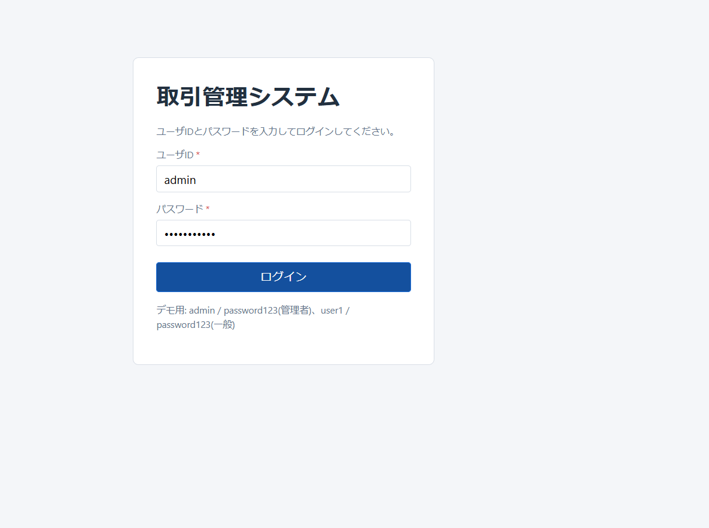

S-02 ホーム（USER）

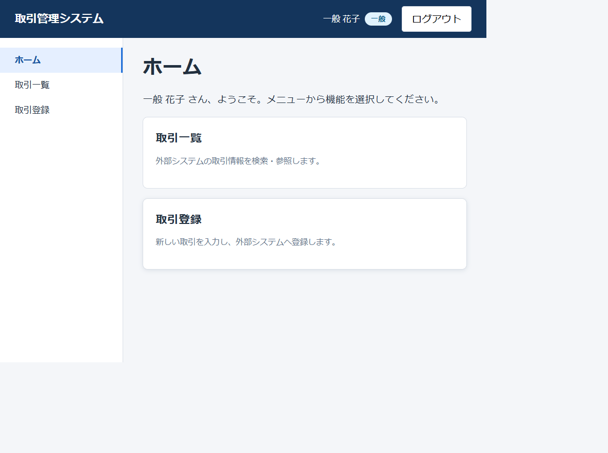

S-03 ユーザ管理（一覧）

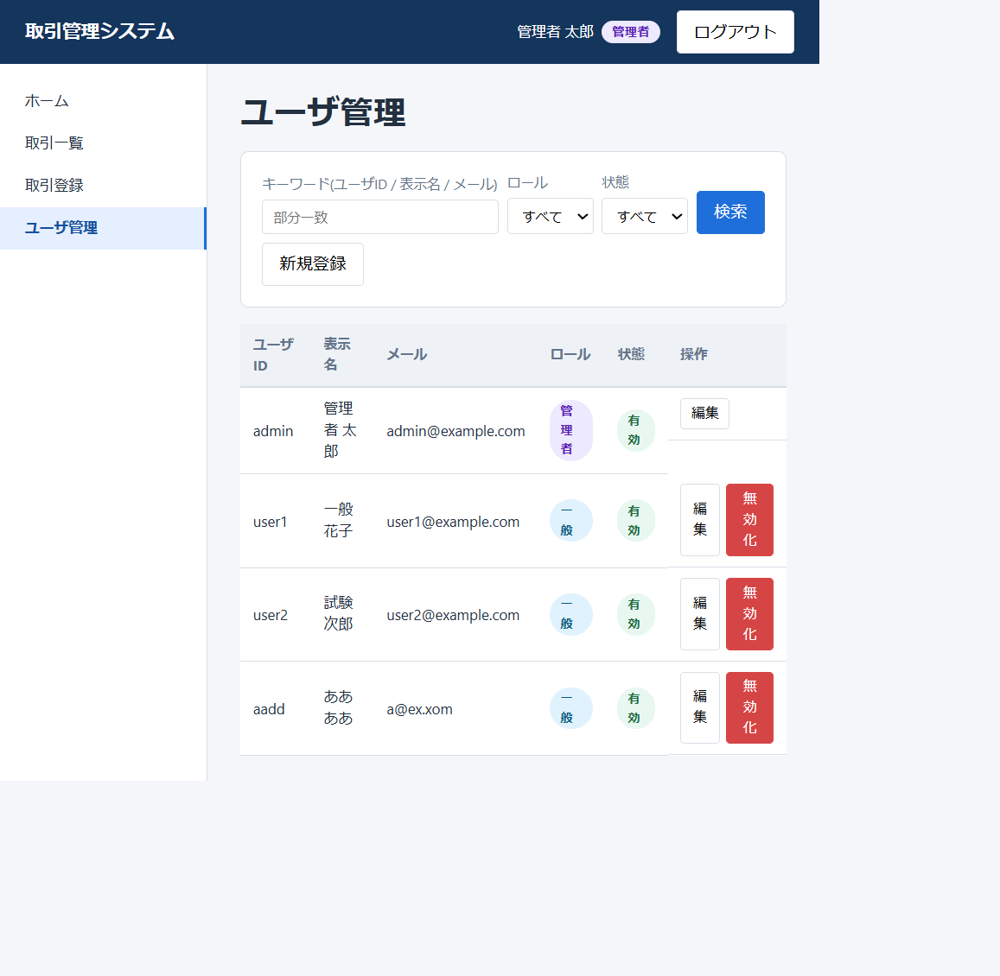

S-03 ユーザ管理（編集）

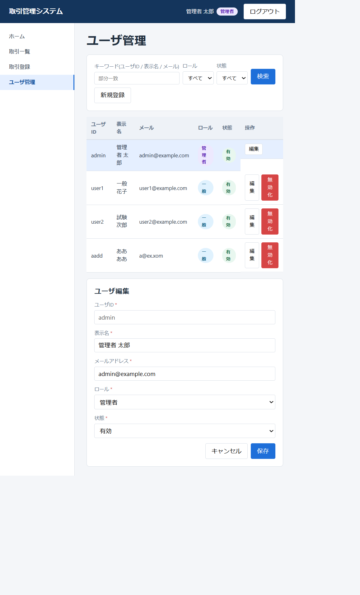

S-04 取引一覧

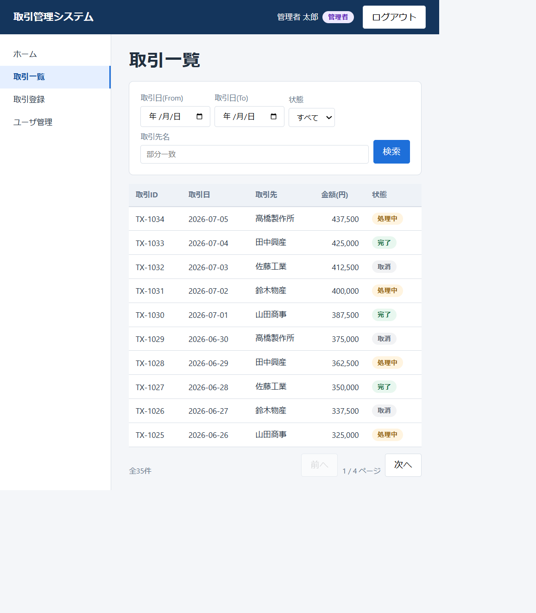

S-05 取引登録（通常）

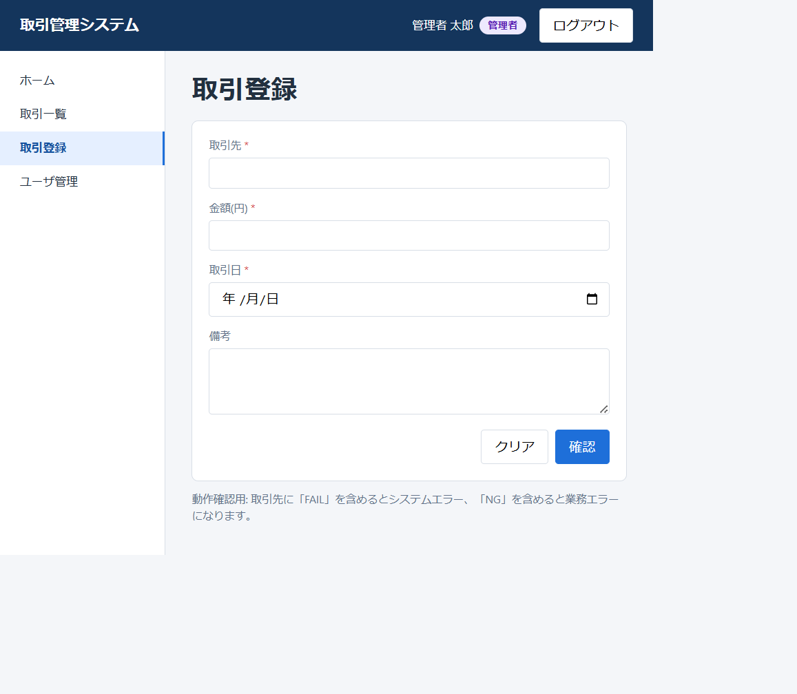

S-05 取引登録（入力エラー）

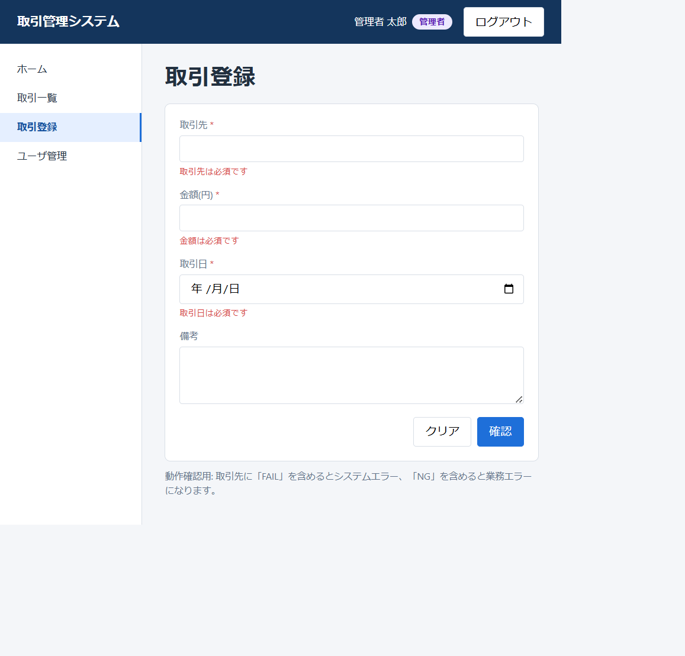

S-05 取引登録（確認）

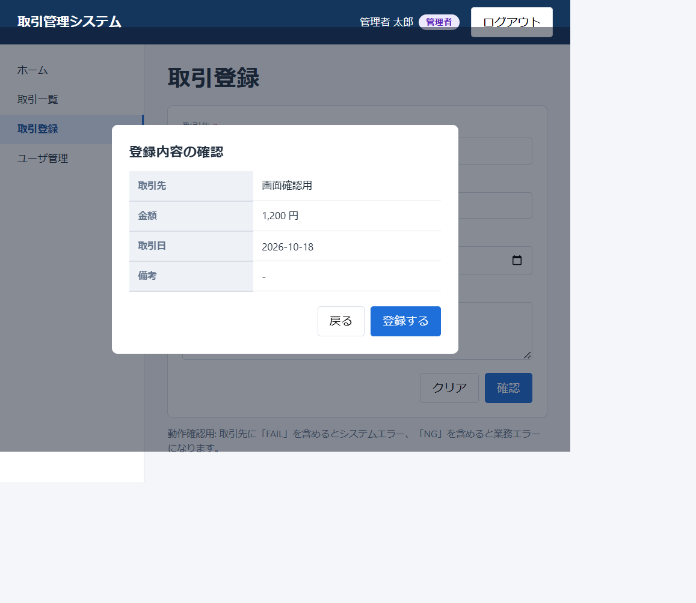

S-06 取引詳細

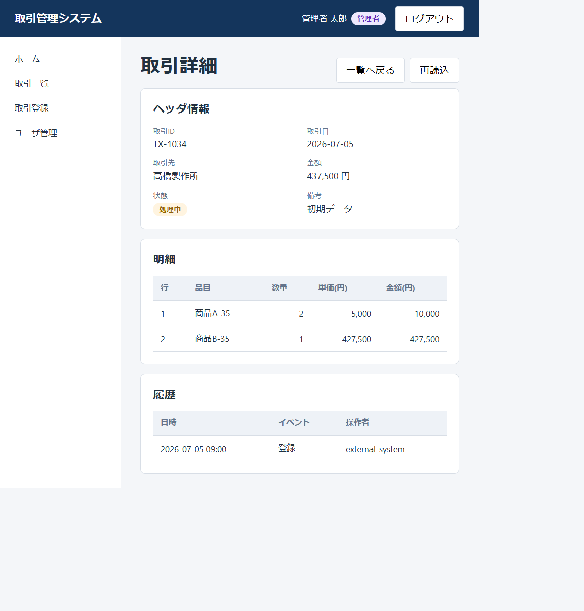

画面構成の概略図は[ワイヤーフレーム](images/screen-wireframes.svg)を参照。キャプチャ内のデータはローカル開発環境のデモデータであり、本番データではない。

## 11. 主な参照元

- [要件案](../../vue-springboot-external-api-requirements.html)
- [画面ルート・認証ガード](../../frontend/src/router/index.ts)
- [共通画面レイアウト](../../frontend/src/components/AppLayout.vue)
- [バックエンド設定](../../backend/src/main/resources/application.properties)
- [認証API](../../backend/src/main/java/com/example/backend/auth/AuthController.java)
- [Spring Security設定](../../backend/src/main/java/com/example/backend/config/SecurityConfig.java)
- [取引API](../../backend/src/main/java/com/example/backend/transaction/TransactionController.java)
- [ユーザ管理API](../../backend/src/main/java/com/example/backend/user/UserController.java)
- [外部APIクライアント](../../backend/src/main/java/com/example/backend/transaction/ExternalApiClient.java)
- [監査ログモデル](../../backend/src/main/java/com/example/backend/audit/AuditLog.java)
