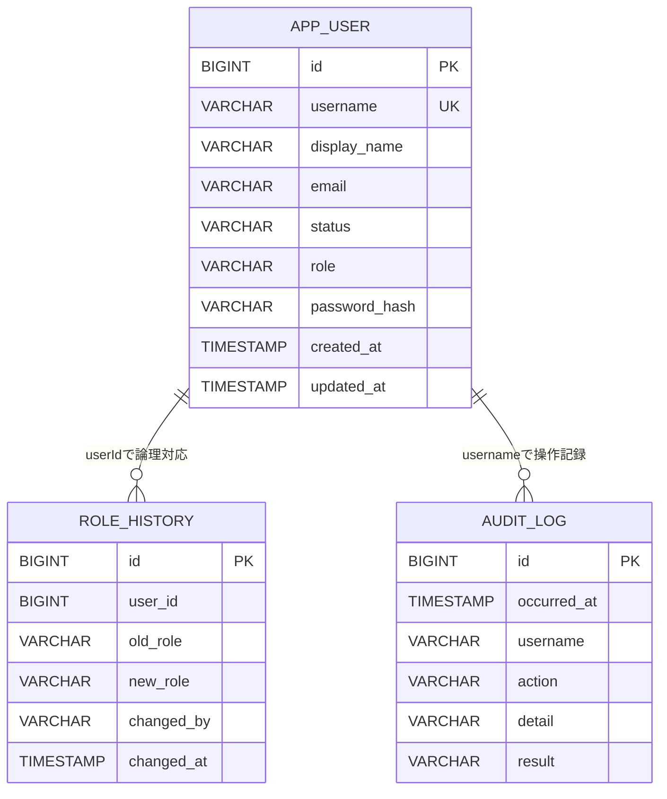

# DB詳細設計

## 1. 文書情報

| 項目 | 内容 |
|---|---|
| 文書ID | D-DB |
| 対象 | BackendがH2へ永続化するデータ |
| DB | H2 file database `./data/appdb` |
| スキーマ管理 | Hibernate `ddl-auto=update` |
| 参照 | [API詳細設計](api-design.md)、[基本設計書](../basic-design.md) |

本書の型・制約はJPAエンティティの宣言に基づく。実際に生成されたDB DDLを直接取得して確認したものではない。インデックス、照合順序、物理カラム名の命名変換など、宣言のない事項は未定義／要確認とする。

## 2. ER概要

`RoleHistory.userId` はJava上の論理参照。JPAの関連アノテーションやDB外部キー制約は宣言されていない。監査ログもユーザIDとのDB参照制約を持たず、usernameを値として記録する。

## 3. `app_user`

| 項目 | Java型 | DB型の目安 | NULL | 制約・生成 |
|---|---|---|---|---|
| `id` | Long | BIGINT | 不可 | 主キー、IDENTITY自動採番 |
| `username` | String | VARCHAR(50) | 不可 | UNIQUE |
| `displayName` | String | VARCHAR(100) | 不可 | 表示名 |
| `email` | String | VARCHAR(255) | 不可 | メールアドレス |
| `status` | Status enum | VARCHAR(20) | 不可 | EnumType.STRING、初期値ACTIVE |
| `role` | Role enum | VARCHAR(20) | 不可 | EnumType.STRING、初期値USER |
| `passwordHash` | String | VARCHAR(100) | 不可 | BCryptハッシュ。平文は保存しない |
| `createdAt` | LocalDateTime | TIMESTAMP相当 | 不可 | `@PrePersist`で設定、更新不可 |
| `updatedAt` | LocalDateTime | TIMESTAMP相当 | 不可 | `@PrePersist`・`@PreUpdate`で設定 |

列名は命名規則による物理名変換に依存する。明示的なカラム名は指定されていない。ロール値はADMIN/USER、状態値はACTIVE/DISABLED。

## 4. `role_history`

| 項目 | Java型 | DB型の目安 | NULL | 制約・生成 |
|---|---|---|---|---|
| `id` | Long | BIGINT | 不可 | 主キー、IDENTITY自動採番 |
| `userId` | Long | BIGINT | 不可 | 対象ユーザID。DB外部キー宣言なし |
| `oldRole` | Role enum | VARCHAR(20) | 可 | EnumType.STRING。初回作成はnull |
| `newRole` | Role enum | VARCHAR(20) | 不可 | EnumType.STRING |
| `changedBy` | String | VARCHAR(50) | 不可 | 操作者のユーザ名 |
| `changedAt` | LocalDateTime | TIMESTAMP相当 | 不可 | `@PrePersist`で設定、更新不可 |

作成時とロール変更時に履歴を追加する。ロールを変更しない更新では履歴を追加しない。参照順は `changedAt` 降順。

## 5. `audit_log`

| 項目 | Java型 | DB型の目安 | NULL | 制約・生成 |
|---|---|---|---|---|
| `id` | Long | BIGINT | 不可 | 主キー、IDENTITY自動採番 |
| `occurredAt` | LocalDateTime | TIMESTAMP相当 | 不可 | `@PrePersist`で設定、更新不可 |
| `username` | String | VARCHAR(50) | 不可 | 操作者。未認証試行等は入力ユーザ名またはanonymous |
| `action` | String | VARCHAR(50) | 不可 | 操作種別 |
| `detail` | String | VARCHAR(500) | 可 | 操作詳細 |
| `result` | String | VARCHAR(20) | 不可 | 結果文字列 |

現行実装で確認できるactionは `LOGIN`, `LOGOUT`, `USER_CREATE`, `USER_UPDATE`, `USER_DISABLE`, `TX_REGISTER`。resultは成功/失敗を表す文字列として保存される。

## 6. 関連・更新規則

- ユーザ作成時、ユーザ行を保存し、ロール履歴（oldRole=null）と監査ログを記録する。
- ユーザのロール変更時、新旧ロールの履歴を保存する。
- ユーザ無効化は物理削除ではなくstatusをDISABLEDに更新する。
- 監査ログは `REQUIRES_NEW` トランザクションで保存し、呼出元業務処理の成否から独立させる。
- 取引データはこのDBに保存しない。Mock External APIのインメモリストアに保持される。

## 7. 初期データ

Backend起動時、ユーザ件数が0の場合のみadmin（ADMIN）とuser1（USER）を作成する。初期パスワードはデモ用 `password123` で、保存前にBCryptでハッシュ化する。Seederはユーザ行のみ作成し、ロール履歴・監査ログは作成しない。

Mock External APIは別プロセス内に35件の取引初期データを作成する。プロセス再起動時に初期化され、H2永続データとは独立する。

## 8. 未定義／要確認

- DBインデックス、テーブル物理名の変換結果、生成DDL
- H2ファイルのバックアップ/リストアと保持期間
- 監査ログ保持期間・アーカイブ・削除方針
- 本番DBへの移行有無、スキーマ変更管理方式

## 9. 参照元

- [ユーザエンティティ](../../../backend/src/main/java/com/example/backend/user/AppUser.java)
- [ロール履歴エンティティ](../../../backend/src/main/java/com/example/backend/user/RoleHistory.java)
- [監査ログエンティティ](../../../backend/src/main/java/com/example/backend/audit/AuditLog.java)
- [監査記録サービス](../../../backend/src/main/java/com/example/backend/audit/AuditService.java)
- [デモユーザ投入](../../../backend/src/main/java/com/example/backend/config/DataSeeder.java)
- [Backend設定](../../../backend/src/main/resources/application.properties)
