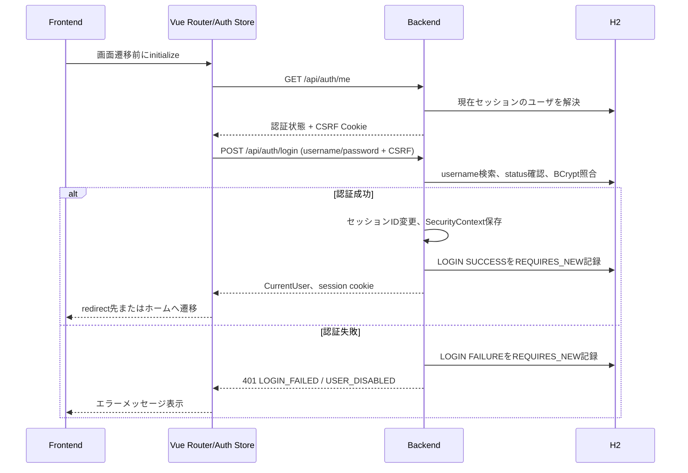
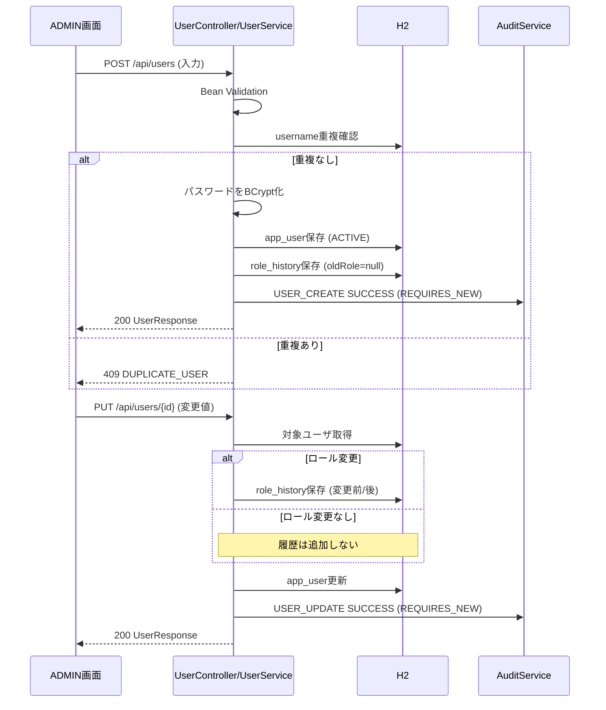
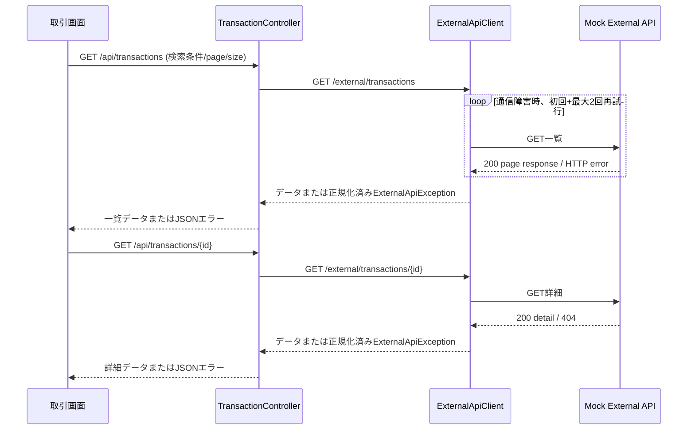
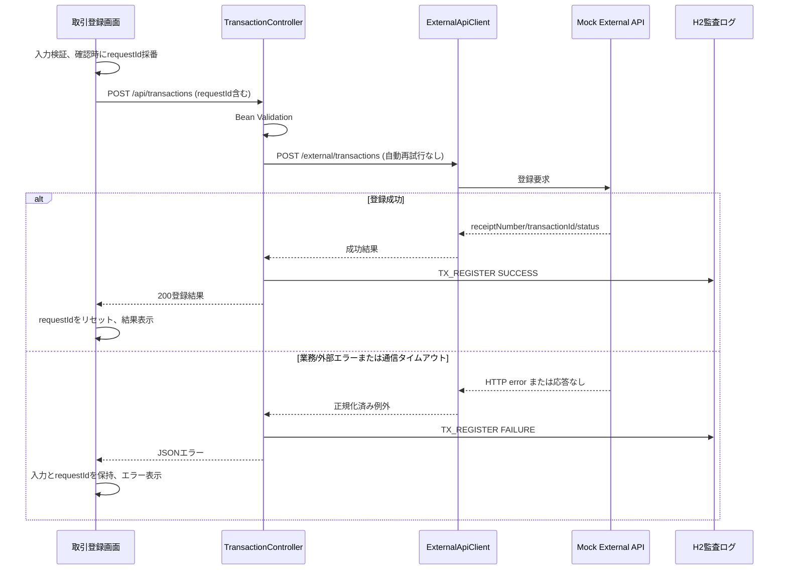

# 主要処理フロー詳細設計

## 1. 文書情報

| 項目 | 内容 |
|---|---|
| 文書ID | D-FLOW |
| 対象 | ログイン、ユーザ管理、取引参照・登録の主要処理順 |
| API契約 | [API詳細設計](api-design.md) |
| 認証 | [認証・認可詳細設計](security-design.md) |
| 外部連携 | [外部API連携詳細設計](external-api-design.md) |

本書では画面のレイアウトやテスト観点を扱わない。

## 2. ログイン・初期化

未認証時の `/api/auth/me` は200 `{authenticated:false}` を返す。遷移開始時にユーザ情報を初期化できない場合、Auth Storeは未認証として扱う。

## 3. ユーザ登録・ロール変更

ユーザ無効化はACTIVEからDISABLEDへの状態更新であり物理削除しない。本人を無効化する要求はサービスで拒否する。監査ログは各処理の記録対象。

## 4. 取引参照

GETの通信障害だけを設定回数再試行する。HTTPエラー応答は再試行せず正規化する。

## 5. 取引登録・冪等性

POSTは更新系であるため自動再試行しない。失敗後の再送に同じrequestIdを用いる。Mock External APIは成功結果をメモリ上に保持し、成功済みIDへの再送では保存結果を返す。失敗応答はMock側に記録しない。

## 6. 監査トランザクション

`AuditService.record()` は `Propagation.REQUIRES_NEW` で監査行を保存する。このため呼出元の業務トランザクションとは独立する。記録できる失敗範囲は呼出し箇所に依存し、全例外を自動記録する仕組みではない。

## 7. 参照元

- [AuthController](../../../backend/src/main/java/com/example/backend/auth/AuthController.java)
- [UserService](../../../backend/src/main/java/com/example/backend/user/UserService.java)
- [TransactionController](../../../backend/src/main/java/com/example/backend/transaction/TransactionController.java)
- [ExternalApiClient](../../../backend/src/main/java/com/example/backend/transaction/ExternalApiClient.java)
- [AuditService](../../../backend/src/main/java/com/example/backend/audit/AuditService.java)
- [Mock ExternalTransactionController](../../../mock-external-api/src/main/java/com/example/mockapi/ExternalTransactionController.java)
