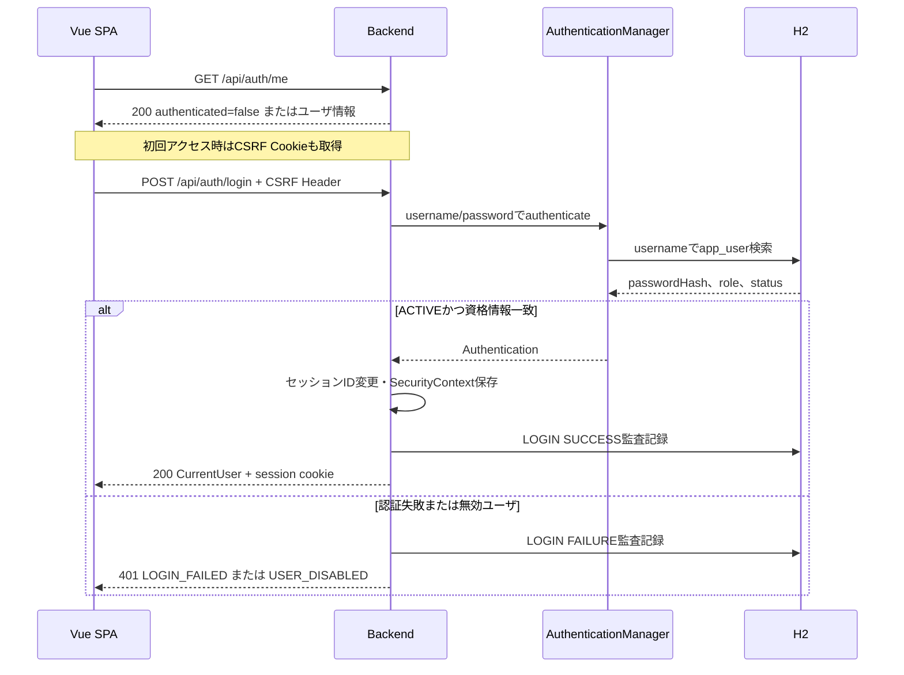

# 認証・認可詳細設計

## 1. 文書情報

| 項目 | 内容 |
|---|---|
| 文書ID | D-SEC |
| 認証方式 | ユーザID・パスワードによるHTTPセッション認証 |
| 認証主体 | H2 `app_user` |
| 関連API | [API詳細設計](api-design.md) |
| 関連画面 | [画面別詳細設計](../screens/README.md) |

本書は現行実装を記述する。要件案のOAuth2 Authorization Code + PKCEとは異なる。

## 2. 認証

- `AppUserDetailsService` はusernameでユーザを検索し、保存済みpasswordHashと `ROLE_{role}` 権限をSpring Securityへ返す。
- statusがDISABLEDのユーザは認証不可として扱う。
- `BCryptPasswordEncoder` でパスワードを照合する。新規登録・Seederでは入力された平文を保存せずBCryptハッシュを保存する。
- フォームログイン・HTTP Basic・Spring Security標準ログアウトは無効化され、`AuthController` がログイン/ログアウトを処理する。

### 2.1 ログインシーケンス

ログイン成功時はセッションを作成して `changeSessionId()` を実行し、SecurityContextをHTTPセッションへ保存する。

### 2.2 ログアウト

`POST /api/auth/logout` は認証必須。Controllerが現在ユーザを特定し、HTTPセッションを無効化、SecurityContextを消去、LOGOUT監査記録を保存して200を返す。

## 3. セッション設定

| 設定 | 値 | 根拠 |
|---|---|---|
| タイムアウト | 30分 | `server.servlet.session.timeout=30m` |
| Cookie HttpOnly | true | application.properties |
| Cookie SameSite | lax | application.properties |
| セッション格納 | HttpSessionSecurityContextRepository | SecurityConfig |
| セッションID再生成 | ログイン成功時に実行 | AuthController |

Secure属性、TLS終端、本番Cookie属性、同時セッション制限は未定義／要確認。

## 4. CSRF

- `CookieCsrfTokenRepository.withHttpOnlyFalse()` を利用する。CSRFトークンCookieはSPAから参照できる。
- SPAは `XSRF-TOKEN` Cookieの値を `X-XSRF-TOKEN` ヘッダーへ転記する。
- `SpaCsrfTokenRequestHandler` はレスポンス側をXORハンドラー、ヘッダー要求の検証を平文ハンドラーで処理する。
- `CsrfCookieFilter` が要求内のCSRFトークンを評価し、Cookie書き出しを確実にする。
- `/h2-console/**` はCSRF検証を除外する。H2 Consoleは同一オリジンframeを許可する設定。
- その他の状態変更APIはCSRF保護対象。CSRF失敗時の個別JSON応答形式はアプリ側ハンドラーとして確認できないため、未定義／要確認。

## 5. 認可

| パス | 条件 |
|---|---|
| `/api/auth/login` | 公開 |
| `/api/auth/me` | 公開 |
| `/h2-console/**` | 公開設定（開発用） |
| `/api/users/**` | `ROLE_ADMIN` |
| その他 `/api/**` | 認証済み |
| その他のリクエスト | denyAll |

USERとADMINは取引APIを利用できる。ADMIN制御は画面メニュー、Vue Routerガード、Spring Securityの3段階。画面の表示制御だけをセキュリティ境界として扱わず、API側ルールを最終認可とする。

## 6. 401/403応答

| 状況 | HTTP | JSON |
|---|---:|---|
| 未認証 | 401 | `{ "code": "UNAUTHORIZED", "message": "認証が必要です" }` |
| 権限不足 | 403 | `{ "code": "FORBIDDEN", "message": "この操作を行う権限がありません" }` |

この応答には `retryable` は付かない。

## 7. 監査記録

`AuditService.record()` は `REQUIRES_NEW` で監査ログを保存する。ログインは成功・認証失敗・無効ユーザ試行、ログアウトは成功を記録する。ユーザ操作・取引登録の記録対象は[DB詳細設計](database-design.md)を参照。

## 8. 未定義／要確認

- パスワード変更・リセット・有効期限・ロックアウト
- セッション失効の運用、最大同時セッション数
- 本番環境のTLS、Secure Cookie、HSTS、CORS
- H2 Consoleの本番利用可否
- CSRF失敗時のAPI応答内容

## 9. 参照元

- [SecurityConfig](../../../backend/src/main/java/com/example/backend/config/SecurityConfig.java)
- [AuthController](../../../backend/src/main/java/com/example/backend/auth/AuthController.java)
- [AppUserDetailsService](../../../backend/src/main/java/com/example/backend/auth/AppUserDetailsService.java)
- [Backend設定](../../../backend/src/main/resources/application.properties)
- [Auth Store](../../../frontend/src/stores/auth.ts)
- [Routerガード](../../../frontend/src/router/index.ts)
