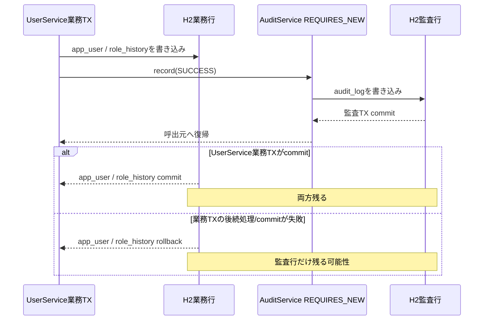
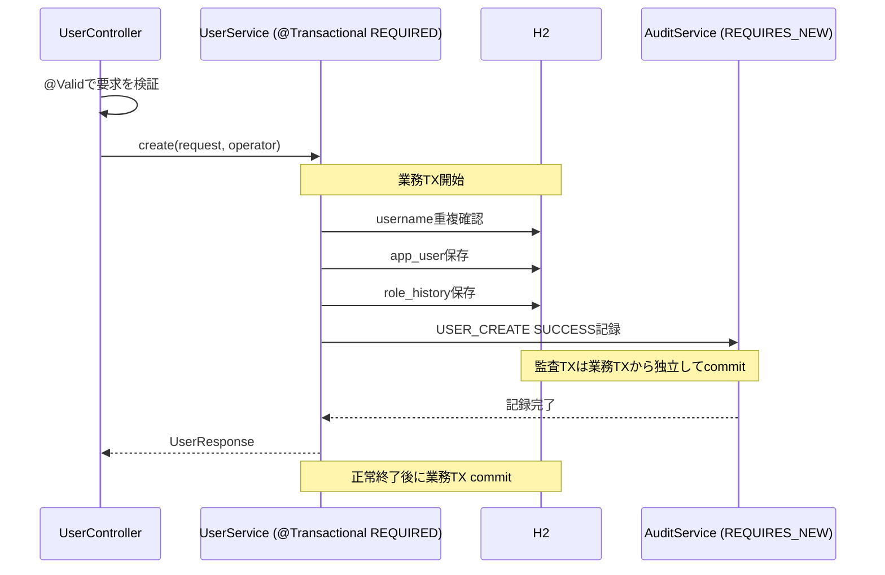
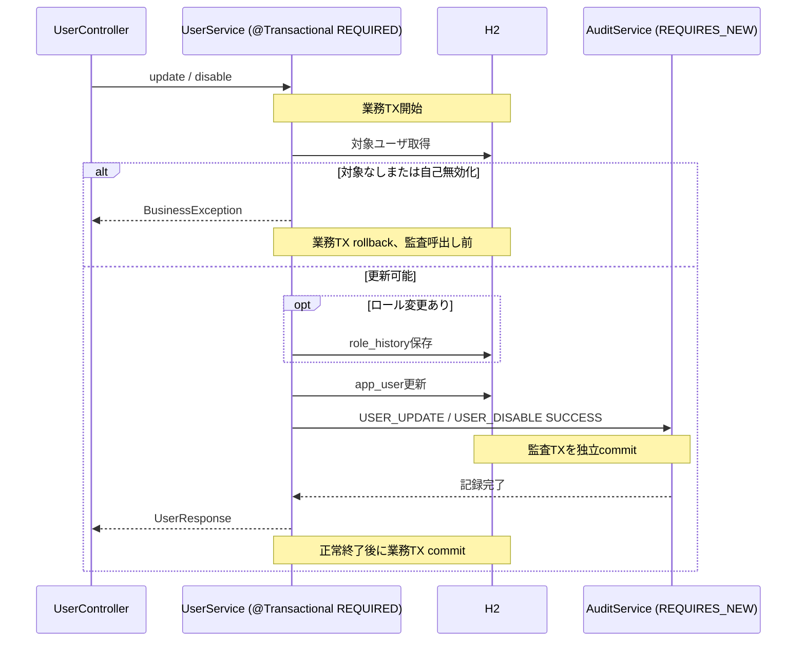
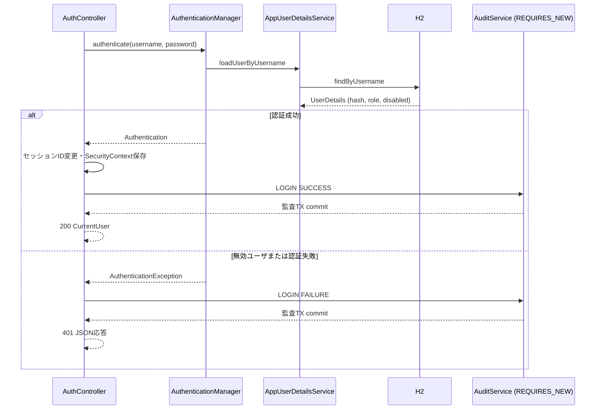
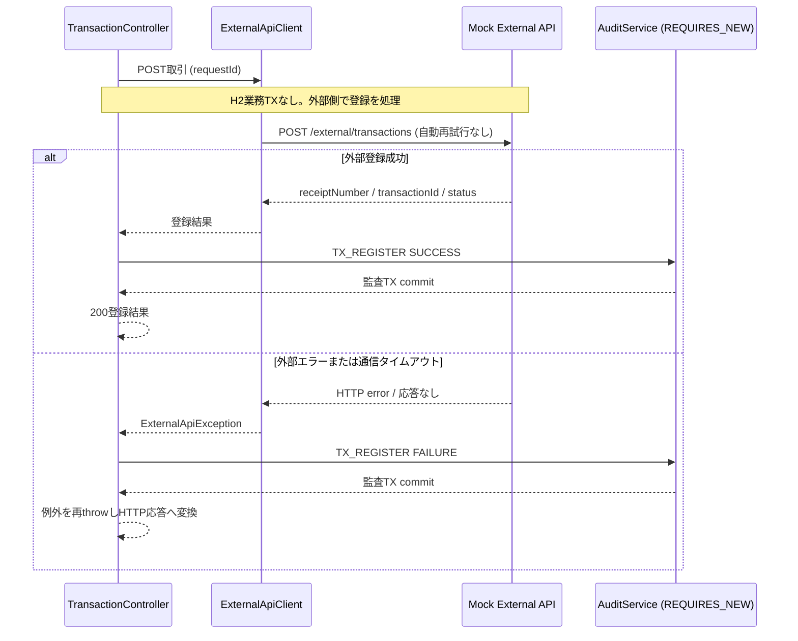

# APIトランザクション制御詳細設計

## 1. 文書情報

| 項目 | 内容 |
|---|---|
| 文書ID | D-TX |
| 対象 | BackendのHTTP APIと、その処理から呼び出すDB/外部API |
| 基本設計 | [基本設計書](../basic-design.md) |
| API契約 | [API詳細設計](api-design.md) |
| DB | [DB詳細設計](database-design.md) |
| 認証・認可 | [認証・認可詳細設計](security-design.md) |
| 外部連携 | [外部API連携詳細設計](external-api-design.md) |

## 2. 読み方と前提

本書では、次の区分を使う。

- **明示設定**: アプリケーションコードにある `@Transactional` 等から確認できる境界。
- **Spring Data規約**: Spring Data JPAのRepository標準トランザクション規約による挙動。アプリケーションコードの明示設定とは区別する。
- **DBトランザクション外**: API処理全体を包むアプリケーションサービスのトランザクションがないこと。個別Repository操作の規約上のトランザクションが存在し得る場合は別記する。

`@Transactional` の属性を省略した場合、Springの標準として伝播は `REQUIRED`、rollback規則は未処理の `RuntimeException` と `Error` でロールバック、チェック例外では自動ロールバックしない。本プロジェクトでは `rollbackFor` / `noRollbackFor` の指定を確認できない。

Controller全体を包む共通トランザクション設定は確認できない。HTTPステータスへの変換はController/`@RestControllerAdvice` で行われるが、サービスのトランザクション判定は例外がサービス境界から戻る時点で行われる。

## 3. APIごとのトランザクション一覧

| API | TX単位 | 明示的TX境界 | DB操作/対象 | 外部・非DB操作 | 正常時 | 失敗時 |
|---|---|---|---|---|---|---|
| `GET /api/auth/me` | `AuthController.me` 未認証分岐 | アプリ明示TXなし | なし | なし | `authenticated=false` を返却 | rollback表を参照 |
| `GET /api/auth/me` | `AuthController.currentUserBody` | アプリ明示TXなし | `app_user SELECT` | なし | `CurrentUser` を返却 | rollback表を参照 |
| `POST /api/auth/login` | `AppUserDetailsService.loadUserByUsername` | アプリ明示TXなし | `app_user SELECT` | なし | `UserDetails` を返却 | rollback表を参照 |
| `POST /api/auth/login` | `AuthController.login` セッションID変更 | アプリ明示TXなし | なし | HTTPセッションID変更 | 新しいセッションIDを設定 | rollback表を参照 |
| `POST /api/auth/login` | `AuthController.login` SecurityContext保存 | アプリ明示TXなし | なし | SecurityContextをHTTPセッションへ保存 | SecurityContextを保存 | rollback表を参照 |
| `POST /api/auth/login` | `AuditService.record(LOGIN)` | `REQUIRES_NEW` | `audit_log INSERT` | なし | LOGIN監査TXをcommit | rollback表を参照 |
| `POST /api/auth/login` | `AuthController.currentUserBody` | アプリ明示TXなし | `app_user SELECT` | なし | `CurrentUser` を返却 | rollback表を参照 |
| `POST /api/auth/logout` | `AuthController.logout` セッション無効化 | アプリ明示TXなし | なし | HTTPセッション無効化 | セッションを無効化 | rollback表を参照 |
| `POST /api/auth/logout` | `AuthController.logout` SecurityContext消去 | アプリ明示TXなし | なし | SecurityContext消去 | SecurityContextを消去 | rollback表を参照 |
| `POST /api/auth/logout` | `AuditService.record(LOGOUT)` | `REQUIRES_NEW` | `audit_log INSERT` | なし | LOGOUT監査TXをcommit | rollback表を参照 |
| `GET /api/users` | `UserService.search` | `readOnly=true` | `app_user SELECT` | なし | 検索結果を返却して読取TXを終了 | rollback表を参照 |
| `POST /api/users` | `UserService.create` 重複確認 | `REQUIRED` | `app_user SELECT` | なし | 重複なしで登録処理を続行 | rollback表を参照 |
| `POST /api/users` | `UserService.create` | `REQUIRED` | `app_user INSERT` | なし | 業務TX commit | rollback表を参照 |
| `POST /api/users` | `UserService.create` | `REQUIRED` | `role_history INSERT` | なし | 業務TX commit | rollback表を参照 |
| `POST /api/users` | `AuditService.record(USER_CREATE)` | `REQUIRES_NEW` | `audit_log INSERT` | なし | USER_CREATE監査TXをcommit | rollback表を参照 |
| `PUT /api/users/{id}` | `UserService.update` 対象取得 | `REQUIRED` | `app_user SELECT` | なし | 更新処理を続行 | rollback表を参照 |
| `PUT /api/users/{id}` | `UserService.update` ロール変更 | `REQUIRED` | `role_history INSERT` | なし | 業務TX commit | rollback表を参照 |
| `PUT /api/users/{id}` | `UserService.update` | `REQUIRED` | `app_user UPDATE` | なし | 業務TX commit | rollback表を参照 |
| `PUT /api/users/{id}` | `AuditService.record(USER_UPDATE)` | `REQUIRES_NEW` | `audit_log INSERT` | なし | USER_UPDATE監査TXをcommit | rollback表を参照 |
| `POST /api/users/{id}/disable` | `UserService.disable` 対象取得 | `REQUIRED` | `app_user SELECT` | なし | 無効化処理を続行 | rollback表を参照 |
| `POST /api/users/{id}/disable` | `UserService.disable` | `REQUIRED` | `app_user.status UPDATE` | なし | 業務TX commit | rollback表を参照 |
| `POST /api/users/{id}/disable` | `AuditService.record(USER_DISABLE)` | `REQUIRES_NEW` | `audit_log INSERT` | なし | USER_DISABLE監査TXをcommit | rollback表を参照 |
| `GET /api/users/{id}/role-history` | `UserService.roleHistories` | `readOnly=true` | `role_history SELECT` | なし | 履歴を返却して読取TXを終了 | rollback表を参照 |
| `GET /api/transactions` | `ExternalApiClient.getWithRetry` | アプリ明示TXなし | なし | `GET /external/transactions` | 外部一覧応答を返却 | rollback表を参照 |
| `GET /api/transactions/{id}` | `ExternalApiClient.getWithRetry` | アプリ明示TXなし | なし | `GET /external/transactions/{id}` | 外部詳細応答を返却 | rollback表を参照 |
| `POST /api/transactions` | `ExternalApiClient.post` | アプリ明示TXなし | なし | `POST /external/transactions` | 外部取引登録結果を受け取る | rollback表を参照 |
| `POST /api/transactions` | `AuditService.record(TX_REGISTER)` | `REQUIRES_NEW` | `audit_log INSERT` | なし | TX_REGISTER監査TXをcommit | rollback表を参照 |

同一の `REQUIRED` 行は同じServiceトランザクションに参加する。各行は、その境界で実行するDB操作または非DB副作用を1つだけ示す。

### 3.1 Repository規約に関する補足

- `UserService` の `search`, `create`, `update`, `disable`, `roleHistories` はサービス層の明示トランザクションでRepository呼び出しをまとめる。
- `AuditService.record` は `REQUIRES_NEW` で監査保存を独立させる。
- `AuthController` と `AppUserDetailsService` から呼ぶ `findByUsername` はアプリコードに `@Transactional` 宣言がない。Spring Data JPAの派生クエリメソッドには、継承CRUDメソッドと同じ既定トランザクション設定が自動で付くとは限らないため、本書ではサービス層の明示的な業務TXとして扱わない。
- `JpaRepository` から継承する `save` などのCRUDメソッドにはSpring Data JPAの既定トランザクション設定がある。ただし、アプリケーションの `@Transactional` がある場合はその外側の境界に参加する。

## 4. コミット・ロールバック規則

### 4.1 `UserService` の業務更新

`create`, `update`, `disable` は `@Transactional` の既定設定で実行される。

- **コミット**: メソッドが例外なく終了し、トランザクション完了時のflush/commitも成功する。
- **ロールバック**: メソッドから未処理のRuntimeExceptionまたはErrorが出た場合、またはcommit時の永続化エラーが発生した場合。
- **チェック例外**: 既定では自動ロールバック対象ではない。対象メソッドでチェック例外は宣言されていない。
- **入力検証**: Controllerの `@Valid` による `MethodArgumentNotValidException` はサービス呼び出し前に処理されるため、UserServiceの業務TXは開始しない。
- **HTTP応答との関係**: `BusinessException` はRuntimeExceptionであり、サービス境界でrollback対象となる。その後 `GlobalExceptionHandler` がHTTP 409へ変換する。応答コードを409にすること自体がrollbackを起こすのではない。

API別の具体的な例外発生点・例外型・rollback対象は、次節の一覧表を正とする。

### 4.2 API別の例外発生点とrollback対象

各行は「1つの例外発生点」と「1つのrollback対象」を表す。rollback対象が複数ある例外は、対象データごとに行を分ける。失敗したINSERT自身が未保存なら、先行して成功した書込みのみを対象にする。「なし」は、その例外発生点でrollbackされるローカルDBデータがないことを示す。

| API | 例外発生点 | 例外/エラー | トランザクション境界 | rollback対象（1行1項目） |
|---|---|---|---|---|
| `GET /api/auth/me` | 認証済みユーザ検索でユーザ行がなく`orElseThrow()`が実行される | `NoSuchElementException` | アプリ明示TXなし | なし（DB更新なし） |
| `GET /api/auth/me` | `findByUsername` のDBアクセスが失敗する | `DataAccessException` | 明示的な業務TXなし | なし（DB更新なし） |
| `POST /api/auth/login` | JSON要求の解析に失敗する | `HttpMessageNotReadableException` | Controller到達前 | なし（DB更新なし） |
| `POST /api/auth/login` | `LoginRequest`のusername/passwordがnullまたは空文字となる | 検証例外は発生しない（`@Valid`なし） | ControllerでAuthenticationManager呼び出し | なし（入力検証によるrollbackなし） |
| `POST /api/auth/login` | 資格情報が一致せず認証例外がcatchされる | `AuthenticationException` | アプリ明示TXなし | なし（ユーザ行の更新なし） |
| `POST /api/auth/login` | ユーザ状態がDISABLEDで認証例外がcatchされる | `DisabledException` | アプリ明示TXなし | なし（ユーザ行の更新なし） |
| `POST /api/auth/login` | 認証用ユーザ検索がDB障害となる | `DataAccessException` | アプリ明示TXなし | なし（ユーザ行の更新なし） |
| `POST /api/auth/login` | 認証失敗監査の`save`が失敗する | `DataAccessException` | AuditServiceのREQUIRES_NEW | なし（監査INSERT未完了） |
| `POST /api/auth/login` | 認証失敗監査のcommitが失敗する | commit例外（具体型は実行時依存） | AuditServiceのREQUIRES_NEW | `audit_log`へのLOGIN監査INSERT |
| `POST /api/auth/login` | 認証成功監査の`save`が失敗する | `DataAccessException` | AuditServiceのREQUIRES_NEW | なし（監査INSERT未完了） |
| `POST /api/auth/login` | 認証成功監査のcommitが失敗する | commit例外（具体型は実行時依存） | AuditServiceのREQUIRES_NEW | `audit_log`へのLOGIN監査INSERT |
| `POST /api/auth/login` | セッション保存後に`currentUserBody()`でユーザが見つからない | `NoSuchElementException` | アプリ明示TXなし | なし（DB更新なし） |
| `POST /api/auth/login` | セッション保存後のユーザ再検索がDB障害となる | `DataAccessException` | アプリ明示TXなし | なし（DB更新なし） |
| `POST /api/auth/logout` | LOGOUT監査の`save`が失敗する | `DataAccessException` | AuditServiceのREQUIRES_NEW | なし（監査INSERT未完了） |
| `POST /api/auth/logout` | LOGOUT監査のcommitが失敗する | commit例外（具体型は実行時依存） | AuditServiceのREQUIRES_NEW | `audit_log`へのLOGOUT監査INSERT |
| `GET /api/users` | role/statusの型変換に失敗する | `MethodArgumentTypeMismatchException` | Service TX開始前 | なし（DB更新なし） |
| `GET /api/users` | `UserService.search()`のSELECTがDB障害となる | `DataAccessException` | UserService.searchのreadOnly TX | なし（読み取りのみ） |
| `GET /api/users` | readOnly TXの終了処理が失敗する | TX終了例外（具体型は実行時依存） | UserService.searchのreadOnly TX | なし（読み取りのみ） |
| `POST /api/users` | JSON要求の解析に失敗する | `HttpMessageNotReadableException` | Controller到達前 | なし（DB更新なし） |
| `POST /api/users` | `@Valid`入力検証に失敗する | `MethodArgumentNotValidException` | UserService TX開始前 | なし（書き込み前） |
| `POST /api/users` | username重複確認SELECTがDB障害となる | `DataAccessException` | UserServiceのREQUIRED TX | なし（保存前） |
| `POST /api/users` | username重複が検出される | `BusinessException`（DUPLICATE_USER） | UserServiceのREQUIRED TX | なし（保存前） |
| `POST /api/users` | `app_user` INSERTが失敗する | `DataAccessException` | UserServiceのREQUIRED TX | なし（成功した先行書き込みなし） |
| `POST /api/users` | `role_history` INSERTが失敗する | `DataAccessException` | UserServiceのREQUIRED TX | `app_user`へのINSERT |
| `POST /api/users` | USER_CREATE監査`save`が失敗する | `DataAccessException` | AuditServiceのREQUIRES_NEW | なし（監査INSERT未完了） |
| `POST /api/users` | USER_CREATE監査例外が伝播する | `DataAccessException` | UserServiceのREQUIRED TX | `app_user`へのINSERT |
| `POST /api/users` | USER_CREATE監査例外が伝播する | `DataAccessException` | UserServiceのREQUIRED TX | `role_history`へのINSERT |
| `POST /api/users` | USER_CREATE監査TXのcommitが失敗する | commit例外（具体型は実行時依存） | AuditServiceのREQUIRES_NEW | `audit_log`へのUSER_CREATE監査INSERT |
| `POST /api/users` | 監査commit例外が伝播する | commit例外（具体型は実行時依存） | UserServiceのREQUIRED TX | `app_user`へのINSERT |
| `POST /api/users` | 監査commit例外が伝播する | commit例外（具体型は実行時依存） | UserServiceのREQUIRED TX | `role_history`へのINSERT |
| `POST /api/users` | UserService業務TXのcommitが失敗する | commit例外（具体型は実行時依存） | UserServiceのREQUIRED TX | `app_user`へのINSERT |
| `POST /api/users` | UserService業務TXのcommitが失敗する | commit例外（具体型は実行時依存） | UserServiceのREQUIRED TX | `role_history`へのINSERT |
| `PUT /api/users/{id}` | JSON要求の解析に失敗する | `HttpMessageNotReadableException` | Controller到達前 | なし（DB更新なし） |
| `PUT /api/users/{id}` | idをLongへ変換できない | `MethodArgumentTypeMismatchException` | Controller到達前 | なし（DB更新なし） |
| `PUT /api/users/{id}` | `@Valid`入力検証に失敗する | `MethodArgumentNotValidException` | UserService TX開始前 | なし（書き込み前） |
| `PUT /api/users/{id}` | 対象ユーザSELECTがDB障害となる | `DataAccessException` | UserServiceのREQUIRED TX | なし（更新前） |
| `PUT /api/users/{id}` | 対象ユーザが見つからない | `BusinessException`（USER_NOT_FOUND） | UserServiceのREQUIRED TX | なし（更新前） |
| `PUT /api/users/{id}` | 操作者本人をDISABLEDにしようとする | `BusinessException`（SELF_DISABLE） | UserServiceのREQUIRED TX | なし（更新前） |
| `PUT /api/users/{id}` | ロール変更時の`role_history` INSERTが失敗する | `DataAccessException` | UserServiceのREQUIRED TX | なし（app_user更新前） |
| `PUT /api/users/{id}` | `app_user` UPDATEのflushが失敗する | `DataAccessException` | UserServiceのREQUIRED TX | `app_user`の更新内容 |
| `PUT /api/users/{id}` | `app_user` UPDATEのflushが失敗する（ロール変更時） | `DataAccessException` | UserServiceのREQUIRED TX | `role_history`へのINSERT |
| `PUT /api/users/{id}` | USER_UPDATE監査`save`が失敗する | `DataAccessException` | AuditServiceのREQUIRES_NEW | なし（監査INSERT未完了） |
| `PUT /api/users/{id}` | USER_UPDATE監査例外が業務TXへ伝播する | `DataAccessException` | UserServiceのREQUIRED TX | `app_user`の更新内容 |
| `PUT /api/users/{id}` | USER_UPDATE監査例外が業務TXへ伝播する（ロール変更時） | `DataAccessException` | UserServiceのREQUIRED TX | `role_history`へのINSERT |
| `PUT /api/users/{id}` | USER_UPDATE監査TX commitが失敗する | commit例外（具体型は実行時依存） | AuditServiceのREQUIRES_NEW | `audit_log`へのUSER_UPDATE監査INSERT |
| `PUT /api/users/{id}` | 監査commit例外が業務TXへ伝播する | commit例外（具体型は実行時依存） | UserServiceのREQUIRED TX | `app_user`の更新内容 |
| `PUT /api/users/{id}` | 監査commit例外が業務TXへ伝播する（ロール変更時） | commit例外（具体型は実行時依存） | UserServiceのREQUIRED TX | `role_history`へのINSERT |
| `PUT /api/users/{id}` | UserService業務TX commitが失敗する | commit例外（具体型は実行時依存） | UserServiceのREQUIRED TX | `app_user`の更新内容 |
| `PUT /api/users/{id}` | UserService業務TX commitが失敗する（ロール変更時） | commit例外（具体型は実行時依存） | UserServiceのREQUIRED TX | `role_history`へのINSERT |
| `POST /api/users/{id}/disable` | 対象ユーザSELECTがDB障害となる | `DataAccessException` | UserServiceのREQUIRED TX | なし（更新前） |
| `POST /api/users/{id}/disable` | idをLongへ変換できない | `MethodArgumentTypeMismatchException` | Controller到達前 | なし（DB更新なし） |
| `POST /api/users/{id}/disable` | 対象ユーザが見つからない | `BusinessException`（USER_NOT_FOUND） | UserServiceのREQUIRED TX | なし（更新前） |
| `POST /api/users/{id}/disable` | 操作者本人を無効化しようとする | `BusinessException`（SELF_DISABLE） | UserServiceのREQUIRED TX | なし（更新前） |
| `POST /api/users/{id}/disable` | `app_user.status` UPDATEのflushが失敗する | `DataAccessException` | UserServiceのREQUIRED TX | なし（成功した先行書き込みなし） |
| `POST /api/users/{id}/disable` | USER_DISABLE監査`save`が失敗する | `DataAccessException` | AuditServiceのREQUIRES_NEW | なし（監査INSERT未完了） |
| `POST /api/users/{id}/disable` | USER_DISABLE監査例外が業務TXへ伝播する | `DataAccessException` | UserServiceのREQUIRED TX | `app_user.status`の更新内容 |
| `POST /api/users/{id}/disable` | USER_DISABLE監査TX commitが失敗する | commit例外（具体型は実行時依存） | AuditServiceのREQUIRES_NEW | `audit_log`へのUSER_DISABLE監査INSERT |
| `POST /api/users/{id}/disable` | 監査commit例外が業務TXへ伝播する | commit例外（具体型は実行時依存） | UserServiceのREQUIRED TX | `app_user.status`の更新内容 |
| `POST /api/users/{id}/disable` | UserService業務TX commitが失敗する | commit例外（具体型は実行時依存） | UserServiceのREQUIRED TX | `app_user.status`の更新内容 |
| `GET /api/users/{id}/role-history` | `role_history` SELECTがDB障害となる | `DataAccessException` | UserService.roleHistoriesのreadOnly TX | なし（読み取りのみ） |
| `GET /api/users/{id}/role-history` | idをLongへ変換できない | `MethodArgumentTypeMismatchException` | Controller到達前 | なし（DB更新なし） |
| `GET /api/users/{id}/role-history` | readOnly TX終了処理が失敗する | TX終了例外（具体型は実行時依存） | UserService.roleHistoriesのreadOnly TX | なし（読み取りのみ） |
| `GET /api/transactions` | 外部一覧APIがHTTPエラー応答を返す | `ExternalApiException`（normalizeでHTTP状態別に生成） | ローカル業務TXなし | なし（ローカルDB更新なし） |
| `GET /api/transactions` | page/sizeをintへ変換できない | `MethodArgumentTypeMismatchException` | Controller到達前 | なし（外部API未呼び出し） |
| `GET /api/transactions` | 外部一覧APIの通信障害が再試行上限に達する | `ExternalApiException`（EXTERNAL_UNAVAILABLE） | ローカル業務TXなし | なし（ローカルDB更新なし） |
| `GET /api/transactions/{id}` | 外部詳細APIが404を返す | `ExternalApiException`（NOT_FOUND） | ローカル業務TXなし | なし（ローカルDB更新なし） |
| `GET /api/transactions/{id}` | 外部詳細APIがその他のHTTPエラーを返す | `ExternalApiException`（normalizeでHTTP状態別に生成） | ローカル業務TXなし | なし（ローカルDB更新なし） |
| `GET /api/transactions/{id}` | 外部詳細APIの通信障害が再試行上限に達する | `ExternalApiException`（EXTERNAL_UNAVAILABLE） | ローカル業務TXなし | なし（ローカルDB更新なし） |
| `POST /api/transactions` | JSON要求の解析に失敗する | `HttpMessageNotReadableException` | Controller到達前 | なし（外部API未呼び出し） |
| `POST /api/transactions` | `@Valid`入力検証に失敗する | `MethodArgumentNotValidException` | 外部呼び出し前 | なし（外部API未呼び出し） |
| `POST /api/transactions` | 外部POSTが400を返す | `ExternalApiException`（INVALID_REQUEST） | ローカル業務TXなし | なし（ローカルDB更新なし） |
| `POST /api/transactions` | 外部POSTが422を返す | `ExternalApiException`（BUSINESS_ERROR） | ローカル業務TXなし | なし（ローカルDB更新なし） |
| `POST /api/transactions` | 外部POSTがその他のHTTPエラーを返す | `ExternalApiException`（EXTERNAL_ERROR） | ローカル業務TXなし | なし（ローカルDB更新なし） |
| `POST /api/transactions` | 外部POSTで通信障害が発生する | `ExternalApiException`（EXTERNAL_TIMEOUT） | ローカル業務TXなし | なし（ローカルDB更新なし） |
| `POST /api/transactions` | 取引失敗監査`save`が失敗する | `DataAccessException` | AuditServiceのREQUIRES_NEW | なし（監査INSERT未完了） |
| `POST /api/transactions` | 取引失敗監査commitが失敗する | commit例外（具体型は実行時依存） | AuditServiceのREQUIRES_NEW | `audit_log`へのTX_REGISTER失敗監査INSERT |
| `POST /api/transactions` | 外部登録成功後の成功監査`save`が失敗する | `DataAccessException` | AuditServiceのREQUIRES_NEW | なし（監査INSERT未完了） |
| `POST /api/transactions` | 外部登録成功後の成功監査commitが失敗する | commit例外（具体型は実行時依存） | AuditServiceのREQUIRES_NEW | `audit_log`へのTX_REGISTER成功監査INSERT |

`app_user` UPDATEのflush失敗は `UserService.update()` の業務TX全体をrollbackする。ロール変更時は、同じTXで先にINSERTした `role_history` も対象となる。

Securityの認証/認可/CSRF拒否、JSON解析失敗、Controller引数変換失敗、Bean Validation失敗はService TX開始前であり、rollback対象はない。LoginRequestには `@Valid` がないため、そのDTOの `@NotBlank` はControllerで検証されない。

Service TXのcommit後に応答生成/送信が失敗しても、完了済みTXはrollbackされない。認証成功後のセッション変更やログアウト時のセッション無効化もDB rollbackの対象外。

取引POSTのタイムアウトでは外部側の登録結果が不明な場合がある。外部状態はローカルrollbackされず、同じ `requestId` の再送で重複登録を抑止する。

#### 例外・状態別の補足

- `BusinessException` は `RuntimeException` であり、`UserService` の `@Transactional` 境界を未処理のまま抜けるためrollback対象となる。`GlobalExceptionHandler` が409へ変換する時点では、サービス境界でrollback判定済み。
- `MethodArgumentNotValidException` はController引数の検証でサービス呼び出しより前に発生する。400応答になるが、該当サービスの業務TXは開始していない。
- ログインの `AuthenticationException` / `DisabledException` はAuthController内でcatchされる。認証失敗そのものがアプリ業務TXをrollbackするわけではなく、Controllerが別途REQUIRES_NEWの失敗監査を記録する。
- 取引登録の `ExternalApiException` はController内でcatchされ、失敗監査後に再throwされる。外部APIのHTTPエラーは外部側が返した結果であり、ローカルDB rollbackとは別。
- Repository/監査保存の `DataAccessException` などRuntimeExceptionが業務TX境界を未処理で抜けるとrollback対象になる。外側でcatchして正常終了させれば既定rollback規則は変わり得るが、該当するUserService処理ではcatchしていない。
- 表に個別列挙していないものでも、`UserService` の業務TX中に発生した未処理のRuntimeException/Errorは既定規則でrollback対象になる。rollback対象の全体は当該TX内で変更されたDB行であり、表ではコード上の主要な書込み単位ごとに分けている。

#### 時系列で見る保存済みデータ

この順序のため、成功監査は業務データcommitの成功を保証するものではない。逆に監査保存が業務TX完了前に失敗すると、監査TXと業務TXの両方がrollbackする。

### 4.3 監査ログの `REQUIRES_NEW`

`AuditService.record()` は呼出元トランザクションを一時中断し、独立したトランザクションで監査行を保存・commitしてから呼出元へ戻る。

- 監査保存成功後に呼出元の業務TXが失敗すれば、監査行は残り、業務変更はrollbackし得る。
- 監査保存自体が失敗し、そのRuntimeExceptionが呼出元へ伝播すると、`UserService` の業務TXもrollbackする。
- 監査が成功しても、後続の業務TX commitが失敗すれば、監査結果と業務データの結果が食い違い得る。
- `create/update/disable` は成功監査を業務メソッドの末尾で記録する。重複・対象なし・自己無効化など、監査呼出しより前に例外となる経路では、その操作の失敗監査を記録しない。

### 4.4 Controllerでcatchする例外

取引登録では `ExternalApiException` をController内でcatchし、失敗監査を記録した後に再throwする。外部例外は `RuntimeException` 由来だが、Controllerに業務DBトランザクションがないため、外部処理をDB rollbackする境界は存在しない。再throw後、`GlobalExceptionHandler` がHTTP応答を生成する。

catchして再throwする経路でも、トランザクションがあれば例外の型・境界を越えるかどうかでrollbackが決まる。HTTP例外応答への変換はrollback規則とは別の処理である。

## 5. API別の主要処理

### 5.1 ユーザ登録

重複チェックまたは入力検証で失敗する場合は保存されない。監査TXが失敗すれば例外が伝播し、業務TXもrollbackする。監査TXが成功した後に業務commitが失敗した場合、成功監査だけが残る可能性がある。

### 5.2 ユーザ更新・無効化

### 5.3 ログインと監査

ログイン処理全体を包む明示的なDBトランザクションはない。認証情報参照、HTTPセッション変更、監査保存は同一原子操作ではない。

### 5.4 外部取引登録

外部登録のcommitと監査DBのcommitは独立する。外部登録が成功した後に監査保存が失敗すると、外部データは残ったままAPIがエラーになる可能性がある。クライアントは同じ `requestId` で再送し、外部側の冪等処理により重複を抑止する。

## 6. HTTP応答とrollbackの対応

| HTTP応答 | 発生例 | rollbackとの関係 |
|---:|---|---|
| 400 | `@Valid` 入力検証、JSON不正 | Service TX開始前ならrollback対象TXなし |
| 401 | ログイン失敗、未認証 | ログイン全体の明示的業務TXなし。失敗監査は別TX |
| 403 | ADMIN権限不足 | Controller/Service処理前の拒否。UserService業務TXなし |
| 409 | `BusinessException` | UserService境界をRuntimeExceptionで抜けるため業務TX rollback |
| 4xx/5xx | 外部APIエラー正規化 | HTTP応答は外部例外を表す。ローカルの外部取引データTXはない |
| 500 | 想定外例外・commit失敗 | 例外がUserServiceのTX完了前に発生すればrollback規則に従う。応答コードだけでは判定しない |

## 7. 現行設計上の限界

- H2と外部APIをまたぐ原子性・分散トランザクションはない。
- 監査 `REQUIRES_NEW` は記録の独立性を高めるが、業務データと監査データの完全一致を保証しない。
- 取引登録で外部成功後に監査保存が失敗した場合、HTTP応答だけでは外部処理結果が不明になり得る。requestId冪等性が重複防止を補完するが、監査記録の再構築までは行わない。
- ユーザ更新系は監査保存失敗時に業務TXもrollbackする一方、監査記録が既にcommit後に業務commitが失敗する逆方向の不整合可能性もある。
- 分離レベル、ロック方針、デッドロック再試行、transaction timeoutは明示設定を確認できないため未定義／要確認。

## 8. 参照元

- [UserService](../../../backend/src/main/java/com/example/backend/user/UserService.java)
- [AuditService](../../../backend/src/main/java/com/example/backend/audit/AuditService.java)
- [AuthController](../../../backend/src/main/java/com/example/backend/auth/AuthController.java)
- [AppUserDetailsService](../../../backend/src/main/java/com/example/backend/auth/AppUserDetailsService.java)
- [TransactionController](../../../backend/src/main/java/com/example/backend/transaction/TransactionController.java)
- [ExternalApiClient](../../../backend/src/main/java/com/example/backend/transaction/ExternalApiClient.java)
- [GlobalExceptionHandler](../../../backend/src/main/java/com/example/backend/common/GlobalExceptionHandler.java)
- [SecurityConfig](../../../backend/src/main/java/com/example/backend/config/SecurityConfig.java)
- [API詳細設計](api-design.md)
- [外部API連携詳細設計](external-api-design.md)
